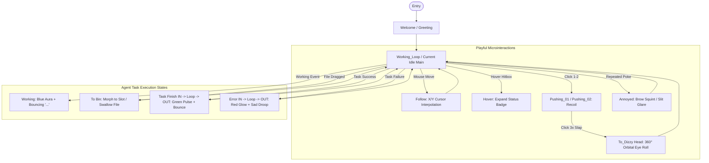

# Grokbot UI, Motion & Functionality Analysis
### End-to-End Deep Analysis of Novra Design's Mascot & Ambient Agent System

> **Source Reference**: [Novra Design — Taking Grok Bot outside the APP](https://www.novra.design/case-studies/grokbot)  
> **Concept Origin**: Independent concept by Novra LTD (London, UK), building upon the xAI Grok Bot character by Benji Taylor and John Bai's macOS notch experiment.  
> **Target Analysis**: Character State Machine, Spatial UI Architecture, Multi-Agent Collapsing Hierarchy, 60fps Vector Motion Physics, and DevEx Interaction Mechanics.

---

## 1. Executive Summary & Product Thesis

Autonomous background agents (coding agents, research bots, pipeline runners) present a fundamental UX paradox: **the user wants them to work asynchronously, yet loses peripheral awareness the moment they switch windows or close the primary app.** 

Novra Design addresses this by decoupling the agent mascot from the chat window and embedding it into ambient system-level surfaces:
- **macOS MacBook Notch**
- **iOS Home Screen Interactive Widgets**
- **iOS Lock Screen Live Activities & Dynamic Island**
- **macOS / iOS Dynamic App Icons**

Instead of reducing agent presence to sterile textual notifications or progress percentages, Novra transforms the mascot into an **expressive, ambient state machine** built in Rive and Figma. The character communicates complex multi-agent execution states while remaining interactive, playful, and responsive to cursor physics.

```
                    ┌──────────────────────────────────────────────┐
                    │          Grok Bot System Architecture        │
                    └──────────────────────┬───────────────────────┘
                                           │
         ┌───────────────────┬─────────────┴─────┬───────────────────┐
         ▼                   ▼                   ▼                   ▼
   [MacBook Notch]    [iPhone Widgets]    [Live Activity]    [Dynamic App Icon]
    Active + Peers     2x2 Grid / Solo     Expanded Capsule   Ambient State Mirror
```

---

## 2. Character System & Visual Design Tokens

The Grok Bot character is a minimalist, vector-based spherical entity designed to convey nuanced emotional and technical status with very few geometric primitives.

| Element | Specification & Styling | Behavior & Visual Role |
| :--- | :--- | :--- |
| **Body Geometry** | Perfect circle / sphere (`border-radius: 50%`) | Base container for vector transforms and spatial mesh warping |
| **Body Gradient** | Vertical linear/radial gradient: Soft metallic slate (`#E2E8F0`) at apex transitioning to atmospheric cyan/ice-blue (`#60A5FA` / `#38BDF8`) at bottom | Radiates subtle ambient glow; shifts hue dynamically during error states |
| **Eyes** | Dual vertical capsule pills (`#000000` pitch black) | Anchor of expression; rotates, squints, blinks, dilates, and deforms across a 3D spherical mesh |
| **Status Badge** | Floating pill or circular beacon anchored to upper-right brow | Displays operational context: 3-dot bouncing bubble (`...`), green success check/dot, or glowing red alert dot |
| **Interaction Container** | Dynamic squircle morph (`border-radius: 28%`) with slotted opening | Triggers on drag-and-drop to "swallow" files directly into the notch |

---

## 3. The Rive State Machine & Emotion Architecture

Novra mapped the complete interaction logic in Figma before compiling the production graph into **Rive**. A fundamental motion design mandate was:
> *"A working state is easy. A character that can mess around while it's working is a little harder. We wanted it to react, interrupt, get annoyed and keep behaving correctly while the user still understands what the agent was actually doing underneath all of that."*



### Detailed State Breakdown

#### 1. `Greeting / Welcome`
- **Trigger**: System startup, app launch, or user unhiding the notch.
- **Visuals**: Winks, blinks, waves an animated hand silhouette, bounces upward, and transitions smoothly into the default idle state.

#### 2. `Working` (Default Task Execution)
- **Visuals**: Ice-blue gradient lower body illumination. A floating blue pill bubble displays three animated dots bouncing in cadence (`...`).
- **Eye Motion**: Subtle breathing idle loop with gentle micro-blinks every 3–4 seconds.

#### 3. `Follow` (Spatial Cursor Tracking)
- **Physics**: 2D vector coordinates mapped across a **3D spherical projection curve**.
- **Inputs in Rive**: `targetX`, `targetY`, `followX`, `followY`.
- **Damping Engine**: A `delayer` dampening curve creates a natural mass lag—the eyes do not snap instantly to the mouse; they smoothly track with organic inertia and decelerate into focus.
- **Spherical Foreshortening**: As the eyes approach the perimeter of the sphere, Rive bone deformation compresses their width and bends their vertical curvature, simulating a 3D ball rotating in space.

#### 4. `Annoyed`
- **Trigger**: User hovering or clicking repeatedly while the bot is attempting to execute work.
- **Visuals**: Blinks sharply into flat horizontal slits, followed by furrowed, angled brows (`-_-`). The eyes lock directly onto the user's cursor with a disgruntled stare before reluctantly recovering to working mode.

#### 5. `Slap & Dizzy` ("Slap it. Try three times.")
- **Trigger**: Three rapid sequential clicks directly on the mascot hitbox.
- **State Path**: `pushing_01` $\to$ `pushing_02` $\to$ `To_Dizzy Head`.
- **Motion**:
  - Click 1 & 2: Elastic compression recoil (squashing downward along the Y-axis and springing back).
  - Click 3: Character knocked sideways; eye capsules detach into orbital motion, spinning $360^\circ$ around the sphere perimeter before drifting back to center with drunken disorientation.

#### 6. `Upload / Ingestion` (`To Bin`)
- **Trigger**: Dragging a file, URL, or code snippet into the notch container.
- **Transform**: The circular body smoothly morphs into an open-topped squircle inbox container.
- **Resolution**: Upon dropping the asset, the opening clamps shut, the character morphs back into a sphere, tilts back, and performs a satisfying "gulp/swallow" spring bounce.

#### 7. `Error`
- **Trigger**: Agent execution failure, API timeout, compilation error, or blocking permission request.
- **Visuals**:
  - Lower body gradient shifts from cool blue to a distressed warm crimson/coral red (`#EF4444`).
  - An urgent red beacon dot pulses rapidly on the brow.
  - Eyes flatten into horizontal drooping, sorrowful slits that blink slowly.

#### 8. `Finished`
- **Trigger**: Successful task resolution or pull request build completion.
- **Visuals**:
  - Blue status bubble transitions into a vibrant emerald green check/dot beacon (`#10B981`).
  - Mascot perks up, eyes dilate happily upward, and the entire head performs a jubilant spring bounce.

---

## 4. Cross-Surface UI Architecture

Novra designed tailored manifestations across four key operating system touchpoints, ensuring functional ergonomics rather than duplicate UI scaling.

```
┌────────────────────────────────────────────────────────────────────────┐
│                        macOS MacBook Notch Island                      │
│ ┌───────────────────────────┐    ┌───────────────────────────────────┐ │
│ │ [ (o o) ] Active Bot      │    │ (•) Asking Research (•) Sending C │ │
│ │   [x] Prep workspace      │    │ (•) Pinging Travel  (•) Looping C │ │
│ └───────────────────────────┘    └───────────────────────────────────┘ │
│     Primary Focus Pane (Left)           Collapsed Peer Matrix (Right)  │
└────────────────────────────────────────────────────────────────────────┘
```

### 1. MacBook Notch Integration
- **Spatial Positioning**: Flanks the hardware camera notch, expanding fluidly into a symmetrical Dynamic Island-style shelf on macOS.
- **Active Agent Focus Pane**:
  - Left container houses the primary active bot with full expressive character head.
  - Live task ticker directly adjacent:
    ```
    [✓] Start working...
    [▶] Prep workspace      <-- Active highlighted task
    [ ] Copy final outputs
    ```
- **Collapsed Peer Matrix**:
  - Right container houses secondary concurrent agents collapsed into compact, color-coded status pills:
    - `Asking Resea...` (Teal pill + mini face)
    - `Sending to C...` (Red/Coral pill + mini face)
    - `Pinging Travel` (Amber pill + mini face)
    - `Looping in Co...` (Purple pill + mini face)
- **Interactive Expansion**: Hovering or clicking the notch shelf smoothly springs open the full timeline, allowing the user to swap active focus between bots instantly.

### 2. iOS Home Screen Interactive Widgets
Novra developed two distinct widget archetypes to serve different user intent:
1. **Multi-Bot Overview (2×2 Grid)**:
   - Displays four compact square quadrants, each dedicated to a background agent.
   - Color-coded ambient backdrops (Teal, Amber, Coral, Violet) allow peripheral status checks at a glance.
2. **Solo Focus View (Full Tile)**:
   - Dedicated single-bot widget card.
   - Large centered Grok Bot mascot with glowing ambient radial lighting.
   - Subtitle header (`Account Manager`) with real-time step checklist underneath (`[▶] Prep workspace`).

### 3. iOS Lock Screen & Live Activities
- **Breaking the Container**: Rather than compressing the mascot inside the standard iOS notification card, Novra **pulled the character head outside the left boundary of the bubble**.
- **Attention Hierarchy**:
  1. The expressive face immediately captures peripheral gaze.
  2. The high-contrast subtitle line underneath conveys the exact delta (`Grok Bot couldn't finish setting up...`).
  3. Dark frosted translucent glass backdrop (`backdrop-filter: blur(20px)`) integrates seamlessly into iOS Always-On Display.

### 4. Dynamic System App Icon
- State extends beyond unread notification counters directly to the **application icon**.
- The app icon artwork dynamically renders the mascot’s active emotion (Working, Sleeping, Annoyed, or Celebrating), turning the macOS dock and iOS home screen into an ambient glanceable dashboard.

---

## 5. Multi-Agent Hierarchy & Collapsing Rules

A critical innovation in Novra's design is solving the multi-agent cognitive load problem:

> *"Several agents can be running at once, so the useful question isn't just what one bot is doing. It's which one needs you. We gave the active bot enough room to show its state and current task, while the others collapse to the minimum: a face and the line they're working on."*

### The "One in Focus, Rest in Sight" Design Law
1. **Never equalize visual weight across multiple background agents.** Equal visual weight causes notification fatigue and visual noise.
2. **Rank by Urgency / Interaction Need**:
   - `Priority 1`: Agent awaiting user permission or blocked by an error (`Error` state takes over primary focus).
   - `Priority 2`: Agent actively streaming output or closest to completion.
   - `Priority 3`: Background autonomous sub-tasks (collapsed into peripheral pills).
3. **Information Density Scaling**:

| View Mode | Mascot Size | Content Displayed | Interaction Target |
| :--- | :--- | :--- | :--- |
| **Primary In-Focus** | Full (64px–96px) | Live task checklist + status badge + 3D cursor follow | Direct click / inspection |
| **Secondary Collapsed**| Micro (20px–24px) | Color hue + eye squint state + truncated task name | Click to swap focus |
| **Widget Grid** | Medium (40px) | Character face + single status indicator | Deep link to agent session |
| **Lock Screen Pill** | Large (48px) | Mascot + high-priority failure/completion banner | Swipe or tap to launch |

---

## 6. Motion Design Tokens & Animation Principles

Based on frame-by-frame vector telemetry from Novra's 60fps WebM recordings:

```
Telemetry Profile:
• Frame Rate: 60.0 fps (Progressive)
• Codec: VP9 Profile 0 (yuv420p)
• Target Resolution: 716x502 (Character isolate) / 1678x1472 (System shell)
• Bitrate: 1,100 kbps – 8,500 kbps (High dynamic range vector curves)
```

### Key Animation Tokens
- **Cursor Tracking Spring**:
  - Damping: `0.75` (Slight playful overshoot without lingering oscillation)
  - Mass: `1.2` (Gives the head a sense of physical weight)
  - Stiffness: `180` (Responsive tracking without feeling robotic)
- **Eye Blink Cadence**:
  - Duration: `180ms` (Quick down-and-up slit transition)
  - Frequency: Random interval between `2.8s` and `4.2s`
  - Asymmetry: Occasional single-eye wink micro-interaction during greeting.
- **3D Foreshortening Transform**:
  - Non-linear vector bezier warp.
  - X-offset to Width Ratio: `cos(θ)` spherical projection simulation.
- **Interruptible State Transitions**:
  - Poking the character while in `Working` mode does **not** reset or halt the agent's background execution.
  - The state machine layers the playful recoil animation on top of the underlying task loop, immediately blending back into `Working` once the user stops interacting.

---

## 7. Comparative DevEx & Agentic UI Analysis

How Novra's Grok Bot model compares to other state-of-the-art agent UI paradigms:

```
                                  [AGENT UI SPECTRUM]
   Sterile CLI / JSON               Ambient Mascot             Traditional Chat
   (Raw Terminal Logs)            (Novra Grok Bot)            (Cursor / ChatGPT)
          │                              │                             │
    High Density,                  High Emotional              High Verbosity,
    Zero Emotional                 Connection, Low             Requires Window
      Glanceability                Cognitive Load                 Dominance
```

| Dimension | Standard Chatbot / IDE (Cursor, Windsurf) | Ambient Mascot (Novra Grok Bot) | System Notification (OS Banners) |
| :--- | :--- | :--- | :--- |
| **Presence** | Trapped inside app window | Pervasive across Notch, Widgets, Lock Screen | Ephemeral banners that vanish |
| **Glanceability** | Low (must read text output) | Instantaneous via character emotion & color | Medium (requires reading banner) |
| **Multi-Agent Management** | Tab switching / split terminals | "One in focus, rest in sight" pill collapsing | Overwhelming banner spam |
| **User Affection & Trust** | Functional / Transactional | Empathetic companion; humanizes background AI | Neutral / Annoying |
| **Interruptibility** | Modal dialogs / Prompt queues | Non-blocking micro-interactions | Action buttons inside banners |

---

## 8. Summary of Contributors & Production Credits

- **Original Character & Concept**: Benji Taylor (Grok Bot Mascot & Motion), John Bai (Initial Mac Notch experiment), xAI Grok Bot Team.
- **Case Study & System Design**: **Novra LTD** (Independent Concept, London, UK).
  - *Creative Direction & Product Design*: AB Babaei, Allen Asgari
  - *Rive & UI Animation*: Rey Dousti, Mobin Maddadi
  - *Illustration & Visuals*: Zakone Samak, Moji Rohi
  - *Sound Design & Framer Build*: Amir Life, Hetch Parsa

---

## 9. Key Takeaways for Agent Product Builders

1. **AI Agents Need an Exterior Presence**: When agents execute long-running background tasks, the application window is the wrong place to keep the user waiting. Move status into the OS periphery.
2. **Expressive Characters Replace Status Spinners**: A character that blinks, looks at the mouse, and exhibits distinct states (Working, Finished, Annoyed, Error) communicates more nuance in 40 pixels than a loading spinner ever can.
3. **Multi-Agent UIs Require Strict Collapsing Laws**: Never give multiple concurrent agents equal screen area. Keep one in focus with full progress details, and collapse secondary peers into color-coded glanceable pills.
4. **Build State Machines That Allow Play**: Making characters interactive and interruptible during active work bridges the gap between utilitarian software and joyful consumer craftsmanship.
